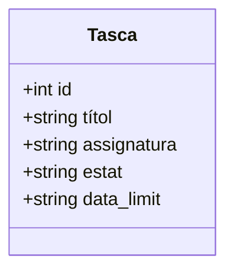

# SPECIFICATIONS.md — Sistema Tasks_app (v2.0)

## 1. Visió General
Tasks_app és una eina CLI lleugera per ajudar als estudiants a gestionar les seves tasques acadèmiques diàries.

## 2. User Stories (Històries d'Usuari)
- US-01: Com a estudiant, vull afegir una tasca amb títol i assignatura per recordar els meus deures.
- US-02: Com a estudiant, vull veure la llista de totes les tasques registrades per organitzar el meu temps i consultar-ne l'estat.

## 3. Model de Dades (Mermaid)

A partir de l'increment 2, les tasques noves incorporen `data_limit`.
Per compatibilitat, les tasques antigues poden no tenir aquest atribut
o tenir-lo amb valor `null`, tal com es defineix a l'apartat 6.6.

## 4. Requisits
- RF-01 : El sistema tasks_app ha de guardar les tasques en un fitxer JSON de persistència local.
- RF-02 : Si el fitxer `data/tasks.json` no existeix, el sistema tasks_app ha de crear `data/tasks.json`  inicialitzat amb una llista JSON buida ([])
- RF-03 : El sistema tasks_app ha de proveir a l'estudiant la capacitat de crear una nova tasca amb estat 'pendent' mitjançant el comandament add --title <títol> --subject <assignatura>.
- RF-04: El sistema tasks_app ha de proveir a l’estudiant la capacitat de visualitzar totes les tasques registrades (incloent-hi el seu ID, títol, assignatura i estat) mitjançant el comandament list.

## 5. Criteris d’acceptació i proves (Gherkin scenarios)
- GS-01: Creació correcta d'una tasca
  Requisits: RF-03, RF-05 i RF-08.

  Atès que `data/tasks.json` conté una llista buida `[]`
  Quan l'estudiant executa:
      python3 src/tasks_app.py add --title "Pràctica 1" --subject "RS" --due 2026-12-10
  Aleshores el sistema mostra a stdout:
      Tasca [ID: 1] creada amb èxit
  I finalitza amb codi de sortida 0
  I stderr queda buit
  I el registre conté una única tasca amb:
      id: 1
      titol: "Pràctica 1"
      assignatura: "RS"
      estat: "pendent"
      data_limit: "2026-12-10"

- GS-02: Llistat de tasques quan `data/tasks.json` no conté registres 
  Atès que la base de dades JSON no conté encara tasques
  quan l’estudiant executa `python src/tasks_app.py list`
  aleshores el sistema mostra `Registre de tasques buit.` 

- GS-03: Llistat de tasques quan data/tasks.json conté registres
  Atès que el fitxer `data/tasks.json` conté les següents tasques:
    | id | títol          | assignatura | estat   |
    | 1  | Pràctica 1     | RS          | pendent |
    | 2  | Examen parcial | SO          | pendent |
  quan l’estudiant executa `python src/tasks_app.py list`
  aleshores el sistema mostra per pantalla:
    "[1] Pràctica 1 (RS) - estat: pendent"
    "[2] Examen parcial (SO) - estat: pendent"

## 6. Increment 2 — Dates límit i actualització de tasques

### 6.1. Objectiu i abast

Ampliar Tasks_app per permetre indicar la data límit de les tasques,
modificar-ne els atributs i marcar-les com a completades.

El llistat ha de permetre identificar les tasques pendents caducades
o urgents.

Aquest increment amplia RF-03 amb l'obligatorietat d'indicar una data
límit en crear tasques noves i amplia RF-04 amb la visualització de
la data límit i les etiquetes corresponents.

La sintaxi de creació definida en aquest increment substitueix la
de l'increment 1. Les tasques antigues sense data límit es conserven
i continuen sent consultables.

### 6.2. Definicions i decisions del grup

- Una tasca pot tenir l'estat `pendent` o `completada`.
- Les tasques noves han de tenir una data límit obligatòria.
- La data límit s'expressa en format `YYYY-MM-DD` i ha de correspondre
  a una data existent al calendari.
- Es permeten dates límit passades.
- La data actual és la data del sistema en el moment d'executar
  el llistat.
- Una tasca pendent està caducada si la seva data límit és anterior
  a la data actual.
- Una tasca pendent és urgent si la seva data límit és igual a la
  data actual o es troba entre un i sis dies després.
- Una tasca que venç exactament al cap de set dies no és urgent.
- Les etiquetes `[CADUCADA]` i `[URGENT]` són mútuament excloents.
- Les tasques completades i les tasques antigues sense data límit
  no reben cap d'aquestes etiquetes.
- L'ID d'una tasca és un enter positiu i no es pot modificar.
- Si una operació es rebutja, no s'aplica cap canvi parcial
  als registres.

### 6.3. Històries d'usuari

- US-03: Com a estudiant, vull indicar la data límit d'una tasca
  quan la creo per tal de conèixer el termini per completar-la.

- US-04: Com a estudiant, vull modificar els atributs d'una tasca
  identificada pel seu ID per tal de corregir errors o actualitzar
  la informació registrada.

- US-05: Com a estudiant, vull marcar una tasca com a completada
  per tal de distingir el treball acabat del que encara tinc pendent.

- US-06: Com a estudiant, vull identificar les tasques pendents
  caducades i urgents en consultar el llistat per tal de prioritzar
  el meu treball.

### 6.4. Requisits

#### Creació de tasques amb data límit

- RF-05: El sistema tasks_app ha de proporcionar a l'estudiant
  la capacitat d'indicar una data límit en crear una tasca mitjançant
  l'opció `--due YYYY-MM-DD` del comandament `add`.

- RF-06: Si l'estudiant intenta crear una tasca sense indicar
  la data límit, el sistema tasks_app ha de rebutjar la creació.

- RF-07: Si l'estudiant introdueix una data límit que no segueix
  el format `YYYY-MM-DD` o que no correspon a una data existent
  al calendari, el sistema tasks_app ha de rebutjar l'operació.

- RF-08: Quan una tasca es crea correctament, el sistema tasks_app
  ha de guardar-ne la data límit al fitxer `data/tasks.json`.

#### Modificació de tasques

- RF-09: El sistema tasks_app ha de proporcionar a l'estudiant
  la capacitat de seleccionar una tasca registrada per modificar-la
  mitjançant l'opció `--id <ID>`.

- RF-10: El sistema tasks_app ha de proporcionar a l'estudiant
  la capacitat de modificar el títol, l'assignatura, la data límit
  i l'estat de la tasca seleccionada.

- RF-11: Quan l'estudiant modifica una tasca, el sistema tasks_app
  ha de conservar el seu ID.

- RF-12: Quan l'estudiant modifica una tasca, el sistema tasks_app
  ha de conservar el valor dels atributs que no s'han indicat
  en l'operació.

- RF-13: Si l'ID indicat no correspon a cap tasca registrada,
  el sistema tasks_app ha de rebutjar l'operació.

- RF-14: Si l'estudiant indica un estat diferent de `pendent`
  o `completada`, el sistema tasks_app ha de rebutjar l'operació.

- RF-15: Quan una modificació es completa correctament,
  el sistema tasks_app ha de guardar els nous valors de la tasca
  al fitxer `data/tasks.json`.

#### Finalització de tasques

- RF-16: El sistema tasks_app ha de proporcionar a l'estudiant
  la capacitat de marcar com a completada una tasca identificada
  pel seu ID.

- RF-17: Quan l'estudiant marca una tasca com a completada,
  el sistema tasks_app ha de guardar el seu estat com a
  `completada` al fitxer `data/tasks.json`.

#### Identificació de tasques caducades i urgents

- RF-18: Si una tasca està pendent i la seva data límit és anterior
  a la data actual, el sistema tasks_app ha de mostrar l'etiqueta
  `[CADUCADA]` en la línia corresponent a aquesta tasca en executar
  el comandament `list`.

- RF-19: Si una tasca està pendent i la seva data límit és igual
  a la data actual o es troba entre un i sis dies després,
  el sistema tasks_app ha de mostrar l'etiqueta `[URGENT]`
  en la línia corresponent a aquesta tasca en executar
  el comandament `list`.

- RF-20: Si una tasca pendent té una data límit situada a set dies
  o més de la data actual, el sistema tasks_app ha de mostrar-la
  sense les etiquetes `[CADUCADA]` i `[URGENT]`.

- RF-21: Si una tasca està completada, el sistema tasks_app
  ha de mostrar-la sense les etiquetes `[CADUCADA]` i `[URGENT]`,
  independentment de la seva data límit.

#### Compatibilitat amb les dades anteriors

- RF-22: El sistema tasks_app ha de permetre carregar i llistar
  les tasques antigues que no tenen data límit.

- RF-23: Si una tasca antiga no té data límit, el sistema tasks_app
  ha de mostrar-la sense les etiquetes `[CADUCADA]` i `[URGENT]`.

#### Tractament dels errors

- RF-24: Quan rebutja una operació, el sistema tasks_app ha de
  mostrar un missatge que identifiqui el motiu del rebuig.

- RF-25: Si una operació es rebutja, el sistema tasks_app ha de
  conservar sense canvis els registres de `data/tasks.json`,
  sense aplicar parcialment els canvis sol·licitats.

### 6.5. Interfície de línia de comandes

Les comandes s'executen des de l'arrel del projecte.

Els elements entre `<...>` representen valors que l'estudiant
ha de substituir. Els claudàtors de la sintaxi de `edit` indiquen
opcions opcionals i no s'escriuen a la terminal.

#### Creació

Comandament:

    python3 src/tasks_app.py add --title "<títol>" --subject "<assignatura>" --due YYYY-MM-DD

Les opcions `--title`, `--subject` i `--due` són obligatòries.

La tasca es crea amb estat `pendent` i un ID incremental,
seguint el comportament de l'increment 1.

Missatge d'èxit:

    Tasca [ID: <ID>] creada amb èxit

#### Modificació

Comandament:

    python3 src/tasks_app.py edit --id <ID> [--title "<títol>"] [--subject "<assignatura>"] [--due YYYY-MM-DD] [--status <estat>]

L'opció `--id` és obligatòria.

Cal indicar com a mínim un dels atributs modificables:
`--title`, `--subject`, `--due` o `--status`.

Es poden modificar diversos atributs en una mateixa operació.
Els atributs no indicats conserven el seu valor.

Els únics valors admesos per a `--status` són `pendent`
i `completada`. Es permet passar d'un estat a l'altre.

L'ID s'utilitza per seleccionar la tasca i no es modifica.

Si algun dels valors indicats és incorrecte, es rebutja tota
l'operació sense aplicar cap dels canvis sol·licitats.

Missatge d'èxit:

    Tasca [ID: <ID>] actualitzada amb èxit

#### Finalització

Comandament:

    python3 src/tasks_app.py complete --id <ID>

L'opció `--id` és obligatòria.

La tasca seleccionada passa a tenir l'estat `completada`.
La resta dels seus atributs es conserven.

Si la tasca ja està completada, es manté aquest estat i es mostra
el mateix missatge d'èxit.

Missatge d'èxit:

    Tasca [ID: <ID>] marcada com a completada

#### Llistat

Comandament:

    python3 src/tasks_app.py list

El sistema mostra les tasques en l'ordre en què estan guardades
al registre.

Si el registre està buit, mostra:

    Registre de tasques buit.

Per a una tasca amb data límit, el format és:

    [<ID>] <títol> (<assignatura>) - estat: <estat> - data límit: <YYYY-MM-DD>

Si la tasca està caducada, s'afegeix un espai i l'etiqueta
`[CADUCADA]` al final de la mateixa línia.

Si la tasca és urgent, s'afegeix un espai i l'etiqueta
`[URGENT]` al final de la mateixa línia.

Per a una tasca antiga sense data límit, es conserva el format
de l'increment 1:

    [<ID>] <títol> (<assignatura>) - estat: <estat>

### 6.6. Persistència de la data límit

La data límit es guarda al JSON amb la clau `data_limit`
i un valor de text en format `YYYY-MM-DD`.

Els atributs existents mantenen els noms `id`, `titol`,
`assignatura` i `estat`.

Exemple de registre nou:

    {
      "id": 1,
      "titol": "Pràctica 1",
      "assignatura": "RS",
      "estat": "pendent",
      "data_limit": "2026-12-15"
    }

Un registre antic sense la clau `data_limit`, o amb aquesta clau
amb valor `null`, s'interpreta com una tasca sense data límit.

El sistema no ha d'assignar automàticament una data límit
a les tasques antigues.

### 6.7. Missatges d'error i codis de sortida

#### Missatges exactes

Si falta l'opció `--due` en crear una tasca:

    Error: cal indicar la data límit amb --due.

Si la data té un format incorrecte o no existeix al calendari:

    Error: data límit no vàlida. Utilitza YYYY-MM-DD amb una data existent.

Si falta l'opció `--id` en modificar o completar una tasca:

    Error: cal indicar l'ID de la tasca amb --id.

Si l'ID no és un enter positiu:

    Error: l'ID ha de ser un enter positiu.

Si l'ID és un enter positiu però no correspon a cap tasca:

    Error: no existeix cap tasca amb ID <ID>.

Si es demana modificar una tasca sense indicar cap atribut:

    Error: cal indicar almenys un atribut per modificar.

Si l'estat indicat no és `pendent` ni `completada`:

    Error: estat no vàlid. Utilitza pendent o completada.

Per a altres errors de sintaxi, com una opció desconeguda,
una opció sense valor o l'absència d'un argument obligatori
no coberta pels missatges anteriors:

    Error: arguments incorrectes. Utilitza --help.

#### Canals de sortida

Els missatges d'èxit i els llistats s'escriuen a la sortida
estàndard (`stdout`).

Els missatges d'error s'escriuen a la sortida d'error (`stderr`).
En cas d'error, `stdout` queda buit.

Cada missatge o línia del llistat acaba amb un salt de línia.
No s'afegeixen línies buides, missatges addicionals ni el text
d'ajuda automàtic quan es rebutja una operació.

#### Codis de sortida

- `0`: operació correcta.
- `2`: arguments incorrectes o operació rebutjada per validació.

### 6.8. Criteris per redactar els escenaris de prova

Els nous escenaris Gherkin es numeraran a partir de GS-04
i indicaran els requisits que verifiquen.

Els escenaris dependents del temps fixaran explícitament
la data actual. Es farà servir `2026-11-23` com a referència:

- `2026-11-22`: data anterior a avui.
- `2026-11-23`: avui.
- `2026-11-29`: sis dies després.
- `2026-11-30`: set dies després.

Cada escenari de rebuig introduirà una sola condició incorrecta,
per poder comprovar el missatge corresponent sense ambigüitats.

L'escenari GS-01 s'ha d'actualitzar perquè el comandament de
creació inclogui `--due`, mantenint l'objectiu de verificar
la creació correcta d'una tasca.

Els escenaris GS-02 i GS-03 es poden conservar utilitzant
registres antics sense data límit.

### 6.9. Escenaris Gherkin de l'increment 2

#### Convencions comunes de verificació

- Cada escenari s'executa de manera independent amb dades temporals.
- Les proves no modifiquen les dades d'exemple del projecte.
- Cada línia de sortida esperada acaba amb un salt de línia.
- Una operació correcta finalitza amb codi 0 i stderr buit.
- Una operació rebutjada finalitza amb codi 2 i stdout buit.
- En una operació rebutjada, els registres guardats conserven
  tots els valors anteriors, sense aplicar canvis parcials.
- Els escenaris que depenen del temps fixen la data actual;
  no depenen de la data real de l'ordinador.

Quan un escenari fa referència a la tasca inicial T1,
es refereix exactament al registre següent:

    {
      "id": 1,
      "titol": "Pràctica 1",
      "assignatura": "RS",
      "estat": "pendent",
      "data_limit": "2026-12-10"
    }

#### Creació i compatibilitat

##### GS-04: Crear una tasca amb data límit vàlida

Requisits: RF-03, RF-05 i RF-08.

Atès que `data/tasks.json` conté una llista buida `[]`
Quan l'estudiant executa:
    python3 src/tasks_app.py add --title "Pràctica 2" --subject "RS" --due 2026-12-10
Aleshores el sistema mostra a stdout:
    Tasca [ID: 1] creada amb èxit
I finalitza amb codi 0 i stderr buit
I guarda una única tasca amb ID 1, títol "Pràctica 2",
assignatura "RS", estat "pendent" i data_limit "2026-12-10".

##### GS-05: Rebutjar la creació sense data límit

Requisits: RF-06, RF-24 i RF-25.

Atès que el registre conté únicament la tasca T1
Quan l'estudiant executa:
    python3 src/tasks_app.py add --title "Pràctica 2" --subject "RS"
Aleshores el sistema mostra a stderr:
    Error: cal indicar la data límit amb --due.
I finalitza amb codi 2 i stdout buit
I el registre continua contenint únicament T1 sense canvis.

##### GS-06: Rebutjar una data amb format incorrecte

Requisits: RF-07, RF-24 i RF-25.

Atès que el registre conté únicament la tasca T1
Quan l'estudiant executa:
    python3 src/tasks_app.py add --title "Pràctica 2" --subject "RS" --due 10/12/2026
Aleshores el sistema mostra a stderr:
    Error: data límit no vàlida. Utilitza YYYY-MM-DD amb una data existent.
I finalitza amb codi 2 i stdout buit
I el registre continua contenint únicament T1 sense canvis.

##### GS-07: Rebutjar una data inexistent al calendari

Requisits: RF-07, RF-24 i RF-25.

Atès que el registre conté únicament la tasca T1
Quan l'estudiant executa:
    python3 src/tasks_app.py add --title "Pràctica 2" --subject "RS" --due 2026-02-30
Aleshores el sistema mostra a stderr:
    Error: data límit no vàlida. Utilitza YYYY-MM-DD amb una data existent.
I finalitza amb codi 2 i stdout buit
I el registre continua contenint únicament T1 sense canvis.

##### GS-08: Llistar una tasca antiga sense data límit

Requisits: RF-22 i RF-23.

Atès que el registre conté únicament una tasca amb ID 1,
títol "Pràctica 1", assignatura "RS" i estat "pendent"
I el registre d'aquesta tasca no té la clau `data_limit`
Quan l'estudiant executa:
    python3 src/tasks_app.py list
Aleshores el sistema mostra a stdout:
    [1] Pràctica 1 (RS) - estat: pendent
I finalitza amb codi 0 i stderr buit
I conserva el registre sense assignar-li cap data límit.

#### Modificació

##### GS-09: Modificar el títol i conservar la resta d'atributs

Requisits: RF-09, RF-10, RF-11, RF-12 i RF-15.

Atès que el registre conté únicament la tasca T1
Quan l'estudiant executa:
    python3 src/tasks_app.py edit --id 1 --title "Pràctica final"
Aleshores el sistema mostra a stdout:
    Tasca [ID: 1] actualitzada amb èxit
I finalitza amb codi 0 i stderr buit
I guarda el títol "Pràctica final"
I conserva l'ID 1, l'assignatura "RS", l'estat "pendent"
i la data_limit "2026-12-10".

##### GS-10: Modificar diversos atributs en una operació

Requisits: RF-09, RF-10, RF-11, RF-12 i RF-15.

Atès que el registre conté únicament la tasca T1
Quan l'estudiant executa:
    python3 src/tasks_app.py edit --id 1 --subject "SO" --due 2026-12-15 --status completada
Aleshores el sistema mostra a stdout:
    Tasca [ID: 1] actualitzada amb èxit
I finalitza amb codi 0 i stderr buit
I guarda l'assignatura "SO", la data_limit "2026-12-15"
i l'estat "completada"
I conserva l'ID 1 i el títol "Pràctica 1".

##### GS-11: Rebutjar una modificació sense aplicar canvis parcials

Requisits: RF-07, RF-24 i RF-25.

Atès que el registre conté únicament la tasca T1
Quan l'estudiant executa:
    python3 src/tasks_app.py edit --id 1 --title "Títol modificat" --due 2026-02-30
Aleshores el sistema mostra a stderr:
    Error: data límit no vàlida. Utilitza YYYY-MM-DD amb una data existent.
I finalitza amb codi 2 i stdout buit
I conserva íntegrament T1
I el títol continua sent "Pràctica 1"
I la data_limit continua sent "2026-12-10".

##### GS-12: Rebutjar la modificació d'un ID inexistent

Requisits: RF-13, RF-24 i RF-25.

Atès que el registre conté únicament la tasca T1
I no existeix cap tasca amb ID 99
Quan l'estudiant executa:
    python3 src/tasks_app.py edit --id 99 --title "Nou títol"
Aleshores el sistema mostra a stderr:
    Error: no existeix cap tasca amb ID 99.
I finalitza amb codi 2 i stdout buit
I el registre continua contenint únicament T1 sense canvis.

#### Finalització

##### GS-13: Completar una tasca i conservar el canvi

Requisits: RF-16 i RF-17.

Atès que el registre conté únicament la tasca T1
Quan l'estudiant executa:
    python3 src/tasks_app.py complete --id 1
Aleshores el sistema mostra a stdout:
    Tasca [ID: 1] marcada com a completada
I finalitza amb codi 0 i stderr buit
I guarda l'estat "completada"
I conserva l'ID, el títol, l'assignatura i la data límit
I, quan es torna a carregar el registre, l'estat continua
sent "completada".

#### Caducitat i urgència

##### GS-14: Mostrar una tasca caducada

Requisits: RF-18.

Atès que la data actual és 2026-11-23
I el registre conté únicament T1 amb data_limit "2026-11-22"
Quan l'estudiant executa:
    python3 src/tasks_app.py list
Aleshores el sistema mostra a stdout:
    [1] Pràctica 1 (RS) - estat: pendent - data límit: 2026-11-22 [CADUCADA]
I finalitza amb codi 0 i stderr buit
I no modifica el registre.

##### GS-15: Mostrar com a urgent una tasca que venç avui

Requisits: RF-19.

Atès que la data actual és 2026-11-23
I el registre conté únicament T1 amb data_limit "2026-11-23"
Quan l'estudiant executa:
    python3 src/tasks_app.py list
Aleshores el sistema mostra a stdout:
    [1] Pràctica 1 (RS) - estat: pendent - data límit: 2026-11-23 [URGENT]
I finalitza amb codi 0 i stderr buit
I no modifica el registre.

##### GS-16: Mostrar com a urgent una tasca que venç en sis dies

Requisits: RF-19.

Atès que la data actual és 2026-11-23
I el registre conté únicament T1 amb data_limit "2026-11-29"
Quan l'estudiant executa:
    python3 src/tasks_app.py list
Aleshores el sistema mostra a stdout:
    [1] Pràctica 1 (RS) - estat: pendent - data límit: 2026-11-29 [URGENT]
I finalitza amb codi 0 i stderr buit
I no modifica el registre.

##### GS-17: No mostrar urgència quan falten exactament set dies

Requisits: RF-20.

Atès que la data actual és 2026-11-23
I el registre conté únicament T1 amb data_limit "2026-11-30"
Quan l'estudiant executa:
    python3 src/tasks_app.py list
Aleshores el sistema mostra a stdout:
    [1] Pràctica 1 (RS) - estat: pendent - data límit: 2026-11-30
I finalitza amb codi 0 i stderr buit
I no modifica el registre.

##### GS-18: No mostrar etiquetes en una tasca completada

Requisits: RF-21.

Atès que la data actual és 2026-11-23
I el registre conté únicament T1 amb estat "completada"
i data_limit "2026-11-20"
Quan l'estudiant executa:
    python3 src/tasks_app.py list
Aleshores el sistema mostra a stdout:
    [1] Pràctica 1 (RS) - estat: completada - data límit: 2026-11-20
I finalitza amb codi 0 i stderr buit
I no modifica el registre.

#### Compatibilitat i validacions addicionals

##### GS-19: Llistar una tasca amb data límit null

Requisits: RF-22 i RF-23.

Atès que el registre conté únicament T1 amb data_limit null
Quan l'estudiant executa:
    python3 src/tasks_app.py list
Aleshores el sistema mostra a stdout:
    [1] Pràctica 1 (RS) - estat: pendent
I finalitza amb codi 0 i stderr buit
I conserva data_limit amb valor null.

##### GS-20: Rebutjar edit sense ID

Requisits: RF-09, RF-24 i RF-25.
Convenció aplicable: apartats 6.5 i 6.7.

Atès que el registre conté únicament la tasca T1
Quan l'estudiant executa:
    python3 src/tasks_app.py edit --title "Nou títol"
Aleshores el sistema mostra a stderr:
    Error: cal indicar l'ID de la tasca amb --id.
I finalitza amb codi 2 i stdout buit
I el registre continua contenint únicament T1 sense canvis.

##### GS-21: Rebutjar complete sense ID

Requisits: RF-16, RF-24 i RF-25.
Convenció aplicable: apartats 6.5 i 6.7.

Atès que el registre conté únicament la tasca T1
Quan l'estudiant executa:
    python3 src/tasks_app.py complete
Aleshores el sistema mostra a stderr:
    Error: cal indicar l'ID de la tasca amb --id.
I finalitza amb codi 2 i stdout buit
I el registre continua contenint únicament T1 sense canvis.

##### GS-22: Rebutjar un ID que no és un enter positiu

Requisits: RF-24 i RF-25.
Convenció aplicable: apartats 6.2 i 6.7.

Atès que el registre conté únicament la tasca T1
Quan l'estudiant executa cadascun dels comandaments següents
en una execució independent:
    python3 src/tasks_app.py edit --id abc --title "Nou títol"
    python3 src/tasks_app.py edit --id 0 --title "Nou títol"
    python3 src/tasks_app.py edit --id -1 --title "Nou títol"
    python3 src/tasks_app.py complete --id abc
    python3 src/tasks_app.py complete --id 0
    python3 src/tasks_app.py complete --id -1
Aleshores cada execució mostra a stderr:
    Error: l'ID ha de ser un enter positiu.
I cada execució finalitza amb codi 2 i stdout buit
I el registre continua contenint únicament T1 sense canvis.

##### GS-23: Rebutjar edit sense atributs per modificar

Requisits: RF-24 i RF-25.
Convenció aplicable: apartats 6.5 i 6.7.

Atès que el registre conté únicament la tasca T1
Quan l'estudiant executa:
    python3 src/tasks_app.py edit --id 1
Aleshores el sistema mostra a stderr:
    Error: cal indicar almenys un atribut per modificar.
I finalitza amb codi 2 i stdout buit
I el registre continua contenint únicament T1 sense canvis.

##### GS-24: Rebutjar un estat no admès

Requisits: RF-14, RF-24 i RF-25.

Atès que el registre conté únicament la tasca T1
Quan l'estudiant executa:
    python3 src/tasks_app.py edit --id 1 --status acabada
Aleshores el sistema mostra a stderr:
    Error: estat no vàlid. Utilitza pendent o completada.
I finalitza amb codi 2 i stdout buit
I el registre continua contenint únicament T1 sense canvis.

##### GS-25: Rebutjar complete amb un ID inexistent

Requisits: RF-13, RF-24 i RF-25.
Convenció aplicable: apartat 6.5.

Atès que el registre conté únicament la tasca T1
I no existeix cap tasca amb ID 99
Quan l'estudiant executa:
    python3 src/tasks_app.py complete --id 99
Aleshores el sistema mostra a stderr:
    Error: no existeix cap tasca amb ID 99.
I finalitza amb codi 2 i stdout buit
I el registre continua contenint únicament T1 sense canvis.

##### GS-26: Completar una tasca que ja està completada

Requisits: RF-16 i RF-17.
Convenció aplicable: apartat 6.5.

Atès que el registre conté únicament T1 amb estat "completada"
Quan l'estudiant executa:
    python3 src/tasks_app.py complete --id 1
Aleshores el sistema mostra a stdout:
    Tasca [ID: 1] marcada com a completada
I finalitza amb codi 0 i stderr buit
I conserva tots els valors del registre sense canvis.

##### GS-27: Tornar una tasca completada a l'estat pendent

Requisits: RF-10, RF-11, RF-12 i RF-15.
Convenció aplicable: apartat 6.5.

Atès que el registre conté únicament T1 amb estat "completada"
Quan l'estudiant executa:
    python3 src/tasks_app.py edit --id 1 --status pendent
Aleshores el sistema mostra a stdout:
    Tasca [ID: 1] actualitzada amb èxit
I finalitza amb codi 0 i stderr buit
I guarda l'estat "pendent"
I conserva l'ID, el títol, l'assignatura i la data límit.

##### GS-28: Crear una tasca amb una data límit passada

Requisits: RF-05 i RF-08.
Convenció aplicable: apartat 6.2.

Atès que la data actual és 2026-11-23
I el registre conté una llista buida `[]`
Quan l'estudiant executa:
    python3 src/tasks_app.py add --title "Tasca endarrerida" --subject "RS" --due 2026-11-22
Aleshores el sistema mostra a stdout:
    Tasca [ID: 1] creada amb èxit
I finalitza amb codi 0 i stderr buit
I guarda una tasca amb ID 1, títol "Tasca endarrerida",
assignatura "RS", estat "pendent" i data_limit "2026-11-22".

##### GS-29: Rebutjar una opció desconeguda

Requisits: RF-24 i RF-25.
Convenció aplicable: apartat 6.7.

Atès que el registre conté únicament la tasca T1
Quan l'estudiant executa:
    python3 src/tasks_app.py list --desconeguda
Aleshores el sistema mostra a stderr:
    Error: arguments incorrectes. Utilitza --help.
I finalitza amb codi 2 i stdout buit
I el registre continua contenint únicament T1 sense canvis.